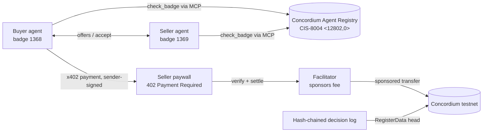

# Verified Deal Room

**AI procurement agents that only negotiate with verified counterparties, settle on their own over x402, and leave an audit-grade record of every decision.**

Built by [Ayon AI Inc.](https://github.com/Sathyagithub1) (Toronto, Canada) for the Concordium Trusted Agents Hackathon. Everything below runs on **Concordium testnet** today, and every claim links to a transaction you can open.

## The problem

Businesses are starting to let AI agents source suppliers, negotiate prices and pay invoices. A supplier can't tell whether an accountable company stands behind the agent it's talking to. Afterwards, neither side can prove what the agent decided or why. Without both, no finance or compliance team will let an agent spend real money.

## What it does

A buyer agent and a seller agent meet in the deal room:

1. **Badge check before anything else.** Each agent asks Concordium's Agent Registry, over its hosted MCP server, whether the other agent's badge verifies: the agent is registered and active, its card is reachable, and the card's hash matches the hash pinned on-chain. Anything else is refused before a single message is exchanged.
2. **Negotiation.** The agents trade offers on price, quantity and lead time. Claude negotiates for both sides, with an optional scripted replay that needs no API key. The buyer never goes above its budget cap, and a party can only accept the other side's offer.
3. **Settlement over x402.** The seller answers `402 Payment Required` with the exact agreed amount. Before signing anything, the buyer checks that the amount equals the agreed total, the recipient is the seller, the network is testnet, the asset is CCD and the cap holds. A facilitator **sponsors the fee**, so the buyer pays only the deal amount.
4. **Decision log, anchored.** Every step (badge checks, each offer, the accept and the payment) goes into a hash-chained log. Its head hash is written on-chain with `RegisterData` and read back to confirm it. Editing any entry afterwards breaks the chain and no longer matches the anchor.
5. **EU AI Act record.** The log exports as a record-keeping bundle containing agent identities, human-set limits, timestamped events and the anchor reference.



## Live on testnet

| What | Proof |
|---|---|
| Buyer agent registered (token 1368, badge `JyP9VYjovVVVqtRQyBhPf`) | [register](https://ccdexplorer.io/testnet/transaction/a47251e4e06d8be9e807f9bf48b2bd90b45886be95a30cd4ca6f45ca4c1476a2) · [pin badged card](https://ccdexplorer.io/testnet/transaction/bd9bc1de23dc7994decf75404b9e47d10fdd7bd4314c89c1b3674b314eea5f1b) · [badge check](https://agent-registry-mcp.concordium.com/v1/check-badge/JyP9VYjovVVVqtRQyBhPf) |
| Seller agent registered (token 1369, badge `JyP9VZqHrWzRg1f9swboB`) | [register](https://ccdexplorer.io/testnet/transaction/9a908985e71bcd0219f1b72c91cba2138ecb47e05388ace6487c228f74ba6568) · [pin badged card](https://ccdexplorer.io/testnet/transaction/d6d2dfd4141d41950b924ee98454ef8f44c075fa495e03d412600aa0cfdb42c6) · [badge check](https://agent-registry-mcp.concordium.com/v1/check-badge/JyP9VZqHrWzRg1f9swboB) |
| Claude-negotiated deal: 100 units at 0.080 CCD = 8 CCD | [x402 payment](https://ccdexplorer.io/testnet/transaction/30b55af306ef1f45fb08ce3dcc5e4b77a24606c929c6dece8eb5d8f33627cf23) · [log anchor](https://ccdexplorer.io/testnet/transaction/b3d2fcc83ed5d00294878ea79cee1a2d9778729005cd25c59aeff9856ae1baad) · [run](runs/demo-2026-11-21T08-18-27-525Z.json) · [EU AI Act record](runs/euaia-record-2026-11-21T08-18-27-525Z.json) |
| Scripted replay with a rogue agent refused | [x402 payment](https://ccdexplorer.io/testnet/transaction/173de7e38e51e636ad728243e48c2fd57d31f1ed4e33160aeeeb7773d161aa52) · [log anchor](https://ccdexplorer.io/testnet/transaction/73d24cbd73db2bbcbcd7ccfc003c95a5511b4fcd055ea08848d387fd3c5c7ae7) · [run](runs/demo-2026-11-21T08-29-23-451Z.json) |
| Building blocks | [anchor smoke](https://ccdexplorer.io/testnet/transaction/4dd9f39b910e69d6c4d7703f3bceb7560ff98fd4392866cfa4289b519c896c74) · [sponsored x402 smoke](https://ccdexplorer.io/testnet/transaction/9eaa3d68e267f2a40f79ae87ce1a78fed30cf85574f85274a3a412d8012f6d89) |

The Claude run took 7 moves: seller 0.12 → buyer 0.065 → 0.10 → 0.075 → 0.088 → buyer 0.080 → seller accepts.

The rogue agent in the replay uses a **well-formed badge** on the real registry contract for a token that was never minted. The registry returns `on_chain_agent_found: false`, and the deal room refuses before negotiating.

## Concordium components used

- **Verified by Concordium badge** (A2A extension) on both agent cards, checked with `check_badge` over the **hosted MCP server**, falling back to REST only if the MCP transport fails.
- **CIS-8004 Agent Registry** `<12802,0>`: `register` mints each agent and `setAgentURI` pins the badged card's sha256.
- **ERC-8004-style agent cards** built with `build_agent_card` / `build_agent_badge`, hosted verbatim in [`cards/`](cards/).
- **x402 with sponsored transactions** (`@x402/concordium`, V1 sponsored transfers): the facilitator adds its sponsor signature and pays the fee.
- **RegisterData** to anchor the decision-log head, with read-back through `getBlockItemStatus`.

**Who stands behind the badges:** both agents are owned by accounts created from one identity, the founder's, issued by the **Concordium testnet identity provider**. Testnet uses no real KYC. On mainnet the same flow uses a real identity provider.

**Real fees (testnet, observed):** about 4.7–4.9 CCD per sponsored transfer, paid by the facilitator, and about 3.6–3.8 CCD per `RegisterData` anchor.

## Run it

Requires Node 22 or later.

```bash
npm install
npm test                      # 72 unit tests, no network
npm run replay                # scripted negotiation, real testnet chain (needs testnet key files)
npm run demo                  # Claude negotiates (needs ANTHROPIC_API_KEY); worst case is checked before any call
npm run export -- runs/demo-<time>.json   # EU AI Act record from a saved run
```

- **Accounts:** chain steps need three testnet accounts (buyer, seller, facilitator), exported from the Concordium Wallet into `.secrets/` (git-ignored, never committed). See [`TESTNET_ACCOUNTS.md`](TESTNET_ACCOUNTS.md) and [`.env.example`](.env.example).
- **Agent registration:** `npm run register -- cards`, then `-- register`, then `-- pin` registers new agents in three phases, because each card must be published between steps.

**Model budget:** at most 8 model calls per run with `max_tokens` 4000. The demo computes the worst-case cost (well under US$5) and aborts before any call if it would exceed the cap.

## Code map

| Path | Role |
|---|---|
| `src/trust/badge-gate.mjs` | Fail-closed decision on a registry verdict |
| `src/concordium/mcp.mjs` | Raw-TLS MCP client for the hosted registry server (its chunked framing breaks `fetch`) |
| `src/concordium/registry.mjs` | Builder payload → registry contract update; hosted-card hash check |
| `src/concordium/chain.mjs`, `anchor.mjs` | gRPC access, sign/submit/wait, anchor + read-back |
| `src/pay/x402.mjs` | Seller paywall, sponsoring facilitator, buyer `assertPayable` guard |
| `src/negotiation.mjs`, `src/claude-agents.mjs` | Alternating negotiation with a hard call cap; Claude deciders |
| `src/log/decision-log.mjs`, `export-euaia.mjs` | Hash-chained log; EU AI Act record |
| `src/deal-room.mjs`, `src/cli/demo.mjs` | Orchestrator and the three-scene demo |

## Pre-existing vs new work

- **Pre-existing, ported:** the negotiation engine and Claude negotiator prompts come from Ayon AI's earlier [Sourcio](https://github.com/Sathyagithub1/sourcio-near) agent (NEAR testnet). They were made currency-agnostic and committed on 17 Nov, together with generic helpers (exact decimal amounts, the hash-chained decision log).
- **New for this hackathon, from the 19 Nov build window:** everything Concordium. That covers the badge gate, the MCP client, registry registration and badges, chain access and anchoring, x402 sponsored settlement, the orchestrator, the demo and the EU AI Act export. Commit history shows the dates.
- **Cut from scope:** A2A transport between the agents. They run in one process, and the badge check is the trust boundary.

## Feeds Ayon Assure

The exported record is the evidence format for Ayon Assure, the AI-governance tooling Ayon AI is developing. Each agent decision becomes a timestamped, hash-linked, on-chain-anchored event that an auditor can verify independently.

## License

MIT
